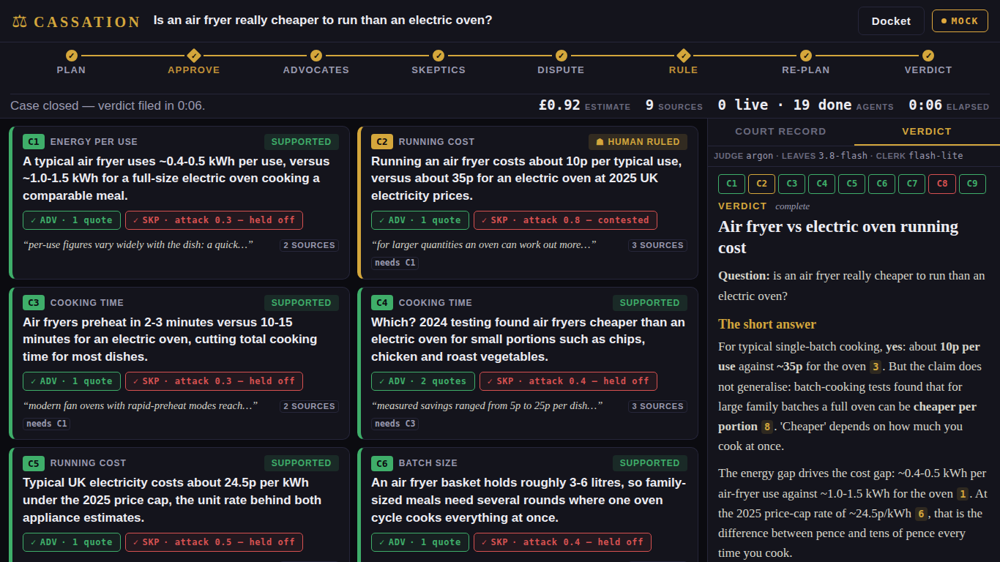

# CASSATION ⚖

**A research court run by a Gemini agent swarm** — built in one day for the *Build with Gemini 4 Argon* hackathon (Imperial College London × Google DeepMind), Track 1: Frontier Agents.

Ask a question you're about to act on ("Is it safe to charge an e-bike battery indoors overnight?"). **Gemini 4 Argon** sits as Judge: it decomposes the question into a claim board, a human approves the plan (and can strike any branch — struck claims provably never run), then ~10 parallel **gemini-3.8-flash** agents fan out with live Google Search grounding: green **Advocates** defend each claim, red **Skeptics** exist only to kill them. A **flash-lite** Clerk scores contradictions; anything genuinely contested goes to a human **Jury** — the agents don't get to settle it. The Judge re-plans on the ruling (same `previous_interaction_id` chain) and streams a cited verdict. Every event is one line in a JSONL trace that is also the WebSocket feed, so any run replays pixel-identically (hotkey `R`) — the demo's offline fallback is the live code path.



## Install & run

```bash
git clone https://github.com/ANQIcai/Cassation.git && cd Cassation
python -m venv .venv
.venv/bin/pip install -r requirements.txt        # Windows: .venv\Scripts\pip
cp .env.example .env                             # put your Gemini API key in .env
.venv/bin/python -m cassation.server             # Windows: .venv\Scripts\python
```

Open **http://localhost:8990**, type a question (or tap a sample), press Enter. Requires Python 3.12+.

- **Live run** (default, needs the key): real search-grounded agents on *your* question; ~2–3 min to a cited verdict.
- **Offline demo**: add `--mock` — a scripted case that needs no key/network (it ignores your question by design).
- **Instant replay**: press `R` anytime to replay the newest completed case through the identical UI (honestly badged REPLAY).
- Phone brief: each verdict serves a mobile page + QR code so you can tap citations through to the sources.

## How it works (for the challenge)

| Judging test | How Cassation answers it |
|---|---|
| Needs Gemini 4 Argon | Argon does the typed claim-graph decomposition, holds every agent transcript + grounded quote in one 1M window for the synthesis (no RAG), and re-plans mid-run on the human ruling via `previous_interaction_id`. Leaves are search-grounded `gemini-3.8-flash`; the clerk/guardrail is `gemini-3.5-flash-lite`. |
| Verification loop | The Skeptic wave is the verification loop, made visible: every supported claim gets an adversary whose only mandate is to refute it, with evidence quotes + resolvable URLs from grounding. |
| Human in control | Two structural gates: plan approval with branch-strike (engine-enforced — struck claims never spawn and are absent from the verdict) and the Jury, a required dataflow node for contested claims, stamped *human-adjudicated* forever. |
| Live, real inputs | Runs live on any typed question. Agents that time out are excluded honestly and the run continues; total network death = one keypress to a same-format replay. |

**Architecture** (contracts in `cassation/PROTOCOL.md`): `cassation/orchestrator/` — engine state machine, Gemini Interactions-API client (streamed, retried, degeneration-repaired), mock client; `cassation/server/` — FastAPI + WebSocket (backlog-then-tail); `cassation/web/` — vanilla JS courtroom UI, no build step. Checks: `scripts/e2e_mock.py`, `scripts/e2e_server.py`.
